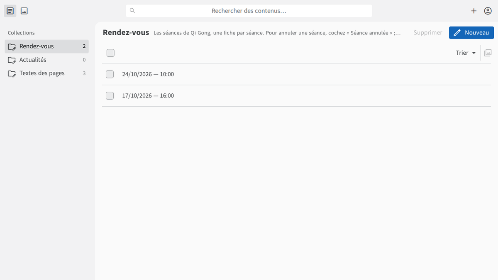
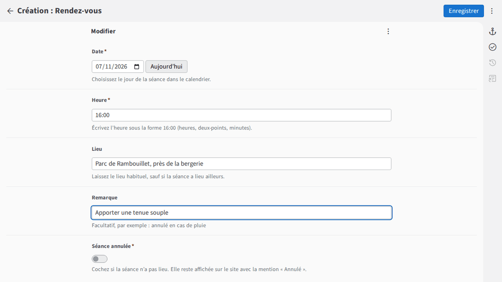
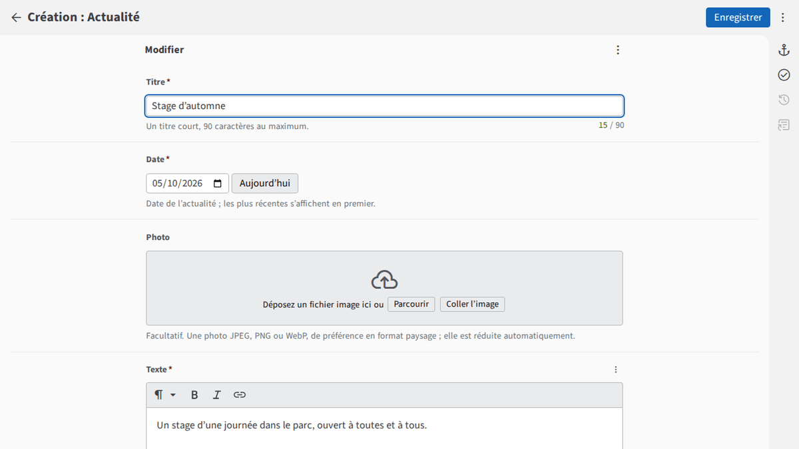
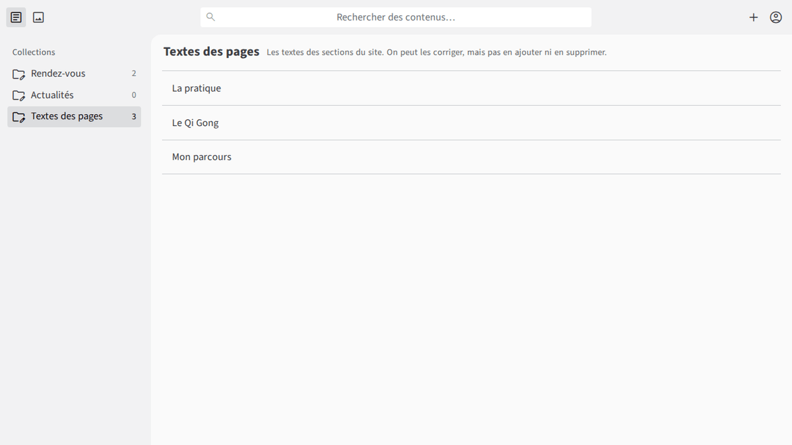

# Guide de l’administration du site Fan 2 Harmonie

Bonjour Stéphanie,

Ce petit guide vous aide à faire vivre votre site : ajouter vos séances, publier une nouvelle, corriger un texte.
Tout se fait depuis votre navigateur, sans rien installer. Une erreur se corrige en modifiant de nouveau la fiche.

## a) Se connecter

**La toute première fois, acceptez l’invitation.** Je vous ai invitée à rejoindre le site sur GitHub :
ouvrez le courriel de GitHub reçu sur votre adresse (regardez aussi dans les indésirables), cliquez sur
**« View invitation »**, puis sur **« Accept invitation »**. Vérifiez au passage que la **double authentification**
est activée sur votre compte GitHub (Settings, puis Password and authentication). L’invitation est valable 7 jours.

Ensuite, à chaque fois :

1. Ouvrez l’adresse **https://fan2harmonie.fr/admin** (gardez-la en favori).
2. Cliquez sur **« Se connecter avec GitHub »**. Une petite fenêtre s’ouvre.
3. Entrez votre identifiant et votre mot de passe GitHub, puis le code de la **double authentification**
   (l’application de votre téléphone). GitHub est le service gratuit qui garde les textes du site en lieu sûr.
4. La toute première fois, GitHub vous demande d’autoriser « Fan 2 Harmonie — administration ». Dans la fenêtre
   GitHub, vérifiez que l’adresse commence par https://github.com/ et que l’application s’appelle bien
   « Fan 2 Harmonie — administration » avant de cliquer sur « Authorize » (le bouton vert). La fenêtre se ferme
   toute seule et vous arrivez sur l’administration.
5. Se déconnecter ne retire pas l’accès à votre compte : si vous perdez votre ordinateur ou votre téléphone,
   prévenez-moi sans attendre, je couperai l’accès.

## b) Ajouter un rendez-vous

1. À gauche, cliquez sur **Rendez-vous**, puis sur le bouton bleu **Nouveau**.
2. **Date** : choisissez le jour dans le calendrier.
3. **Heure** : écrivez-la sous la forme **16:00**.
4. **Lieu** : laissez ce champ vide pour le lieu habituel (celui des « Réglages du site »), sauf si la séance a lieu ailleurs.
5. **Remarque** (facultatif) : par exemple « annulé en cas de pluie ».
6. Cliquez sur **Enregistrer** en haut à droite. Le message « Entrée enregistrée. » confirme l’enregistrement.

*(Capture ancienne : le champ « Lieu » est maintenant vide pour le lieu habituel.)*

## c) Annuler une séance

Ouvrez le rendez-vous dans la liste, activez **« Séance annulée »** (l’interrupteur),
puis **Enregistrer**. La séance reste affichée sur le site, barrée, avec la mention **« Annulé »** : vos élèves
savent ainsi qu’elle n’a pas lieu.

## d) Supprimer un rendez-vous

Pour retirer une séance du site : dans la liste des rendez-vous, cochez la case devant la séance,
puis cliquez sur **Supprimer** et confirmez.

## e) Publier une actualité avec une photo

*(Capture ancienne : le champ s’appelle maintenant « Photos » et accepte plusieurs photos.)*

1. À gauche, cliquez sur **Actualités**, puis sur **Nouveau**.
2. **Titre** : court, 90 caractères au maximum.
3. **Date** : les actualités les plus récentes s’affichent en premier.
4. **Photos** (facultatives) : sous **« Photos »**, cliquez sur le bouton d’ajout, puis sur **Parcourir** et choisissez une photo (format JPEG, PNG ou WebP). Elle est réduite automatiquement : pas besoin de la retoucher.
   Ne publiez pas la photo d’une personne reconnaissable sans son accord.
5. **Texte** : écrivez votre nouvelle. Les boutons au-dessus permettent de mettre un mot en **gras** ou en
   *italique*, ou d’ajouter un lien.
6. **Enregistrer**.

## f) Publier une actualité avec plusieurs photos

Dans la même fiche, le champ **« Photos »** accepte jusqu’à **12 photos**.

1. Sous **« Photos »**, cliquez sur le bouton d’ajout, puis sur **Parcourir** pour choisir une première photo.
2. **« Légende »** (facultative) : une courte phrase qui décrit la photo, pour les personnes qui ne la voient pas.
3. Pour une autre photo, cliquez de nouveau sur le bouton d’ajout. Les petites icônes à côté de chaque photo
   permettent de la déplacer ou de la retirer.
4. **Enregistrer**. Sur le site, un clic sur une photo l’ouvre en grand. L’accueil affiche vos six dernières actualités.

## g) Corriger un texte

À gauche, cliquez sur **Textes des pages**, puis sur la section à corriger : **La pratique**, **Le Qi Gong** ou
**Mon parcours**. Modifiez le texte comme dans un traitement de texte, puis **Enregistrer**.

- Pour passer à la ligne, laissez **une ligne vide** entre deux paragraphes (appuyez deux fois sur « Entrée »).
- Écrivez simplement : les boutons suffisent pour le gras et l’italique.

## h) Modifier la page d’accueil

À gauche, cliquez sur **« Réglages du site »**, puis sur **« Page d’accueil »**. Vous y trouvez la phrase d’accroche,
le titre, le sous-titre, la devise, les petites lignes d’informations pratiques, le texte du bouton et les bienfaits
(pour chacun, choisissez le dessin et écrivez quelques mots). Les limites de longueur sont indiquées sous chaque
champ. Cliquez sur **Enregistrer** : rien ne change sur le site avant.

**« Questions fréquentes »** : en bas de la fiche, ajoutez vos questions et leurs réponses (8 au plus). Elles
s’affichent dans « La pratique » et Google les connaît. N’y écrivez pas d’heure, elle changerait d’une séance à l’autre.

**Menu et titres** : dans **« Réglages du site »**, la fiche **« Menu et titres »** change les mots du menu en haut de la page et les trois titres « Prochains rendez-vous », « Actualités » et « Contactez-moi ». Ni l’ordre des liens ni les sections visées ne changent.

## i) Modifier le lieu

Dans **« Réglages du site »**, cliquez sur **« Lieu de la pratique »** : le nom du lieu, sa latitude et sa longitude
(deux nombres avec des décimales : dans Google Maps, un clic droit sur le lieu les affiche), et les indications pour
s’y rendre. Le nom est le lieu habituel de vos rendez-vous ; les deux nombres servent au lien « Google Maps » du site. Puis **Enregistrer**.

Le nom du lieu est public : jamais d’adresse personnelle. Si le lieu change, modifiez aussi la première ligne de « Page d’accueil » et la réponse « Où … » des questions fréquentes.

## j) Référencement Google

Dans **« Réglages du site »**, la fiche **« Référencement Google »** contient le titre et la description que Google
affiche sous le nom de votre site. Elle contient aussi le **code de vérification Google**, à coller une seule fois.
Pour que Google connaisse votre site, suivez la procédure : [`PROCEDURE-GOOGLE.md`](PROCEDURE-GOOGLE.md).

## k) Quand le site se met-il à jour ?

Après chaque enregistrement, **le site se met à jour en quelques minutes** (en pratique, environ 2 minutes).
Rechargez alors la page du site.

Si rien n’a changé au bout de cinq minutes : rechargez la page en appuyant sur **Ctrl + F5** (ou, sur téléphone,
fermez et rouvrez la page). Si le changement n’apparaît toujours pas après un quart d’heure, ce n’est pas grave :
votre modification est bien gardée, écrivez-moi.

## l) En cas de doute

Chaque modification est gardée : en cas d’erreur, je peux toujours remettre une version précédente
(vous ne pouvez pas le faire vous-même). Si quelque chose vous paraît étrange, écrivez-moi en décrivant ce que vous avez fait et ce que vous voyez (une
capture d’écran aide beaucoup).

## m) Bon à savoir

- **Deux rendez-vous le même jour** (le matin et l’après-midi) : c’est possible.
- **Les rendez-vous passés disparaissent tout seuls** du site : dès le lendemain, puis
  lors de la mise à jour de la nuit. Inutile de les supprimer.
- **Ce qui est supprimé n’est pas effacé partout** : les fichiers du site sont gardés sur GitHub avec leur
  historique, que seules les personnes autorisées sur GitHub peuvent consulter. Une photo ou un texte supprimé du site reste
  visible dans l’historique. Réfléchissez donc avant de publier une information personnelle.
- **Les messages du formulaire de contact** arrivent dans votre boîte **contact@fan2harmonie.fr**, que vous lisez
  sur **https://mail.ovh.net**. Supprimez les messages une fois traités : ils ne doivent pas être gardés plus de
  12 mois après le dernier échange.
- **Les photos sont recadrées** sur le site : placez ce qui compte au centre. Une photo en largeur donne le
  meilleur résultat.
- **Quelques mots de l’outil restent en anglais**, par exemple « Show Errors » ou « Restore Default » : c’est
  normal, vous pouvez les ignorer.
- **Le champ Photos** affiche, une fois la photo choisie, un chemin un peu technique
  (« ../../assets/actualites/… ») : c’est normal, n’y touchez pas.
- **Formulaire de contact** : si un visiteur rencontre une erreur en envoyant un message, le site lui affiche
  votre adresse e-mail.
- **Ne communiquez jamais votre mot de passe GitHub**, à personne (pas même à moi) ; ni le code de la
  double authentification. Personne n’en a besoin pour vous aider.
- Sur un ordinateur partagé, pensez à vous déconnecter : cliquez sur le petit bonhomme en haut à droite, puis
  sur « Se déconnecter ».

Bonne publication !
